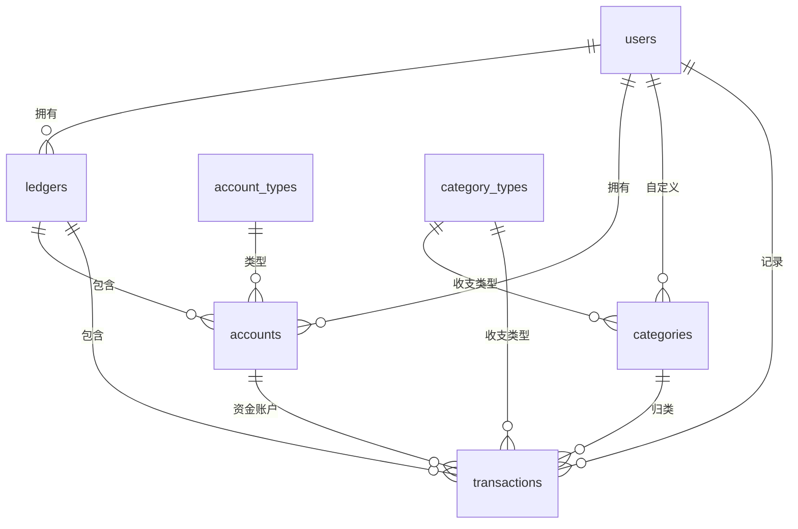

# 财务管家数据库设计说明

> 版本：V1.0  
> 数据库：`finance_manager`  
> 兼容：MySQL 8.0+ / 9.x（已在 MySQL 9.7.0 实测通过）  
> 角色：数据库管理员（DBA）

---

## 1. 交付物

| 文件 | 说明 |
|------|------|
| `init_database.sql` | 建库、建表、索引、约束、触发器、视图、预置数据（可重复执行） |
| `verify.sql` | 结构校验 + 引用完整性检查 + 事务内冒烟测试（自动回滚） |
| `README.md` | 设计说明、数据字典、部署与优化建议 |

## 2. 设计依据与范围

- 《财务管家 PRD V1.0.1》：用户注册登录、记账、账户、分类、统计、导出
- 《财务管家后台管理系统 PRD》：现有 8 张表 + 只读管理后台 + `admins` 表
- `003.前端代码（前端工程师）/backend/server.js`：实际执行的 SQL 与字段
- `003.前端代码（前端工程师）/frontend`：页面实际使用的字段（主题、头像、账户余额等）

设计覆盖当前已实现的 V1.0.1 功能，并为 PRD 中 V1.1 的「多账本 / 预算 / 共享」预留了基础结构（`ledgers` 表），但不提前创建未使用的业务表。

## 3. 数据库概览

| 项目 | 取值 |
|------|------|
| 数据库名 | `finance_manager`（与 `backend/.env` 中 `DB_NAME` 一致） |
| 字符集 | `utf8mb4`（支持中文、Emoji 分类图标） |
| 排序规则 | `utf8mb4_0900_ai_ci` |
| 存储引擎 | InnoDB（事务、行锁、外键） |
| 金额类型 | `DECIMAL(14,2)`（禁止用浮点存金额） |
| 时间类型 | `DATETIME` / `DATE`（使用服务器本地时区） |

## 4. 实体关系（ER）



核心关系说明：

- 一个用户拥有多个账本、账户、自定义分类和交易记录；
- 系统预置分类由所有用户共享（`categories.user_id IS NULL`）；
- 一笔交易同时关联：用户、账本、账户、分类、收支类型；
- 账户余额由交易流水通过触发器自动维护。

## 5. 表清单

| 表名 | 名称 | 说明 | 数据量级 |
|------|------|------|----------|
| `users` | 用户表 | 注册、登录、个人资料 | 万级 |
| `ledgers` | 账本表 | 注册时创建默认账本，支持多账本扩展 | 万级 |
| `account_types` | 账户类型表 | 现金、银行卡、微信、支付宝等（字典表） | 十级 |
| `accounts` | 账户表 | 用户资金账户及余额 | 十万级 |
| `category_types` | 分类类型表 | 收入 / 支出（字典表） | 个级 |
| `categories` | 分类表 | 系统预置 + 用户自定义分类 | 千级 |
| `transactions` | 交易记录表 | 收支流水，系统核心表 | 百万级 |
| `admins` | 管理员表 | 后台管理系统登录，独立于用户体系 | 十级 |

## 6. 数据字典

### 6.1 users 用户表

| 字段 | 类型 | 约束 | 说明 |
|------|------|------|------|
| `id` | BIGINT UNSIGNED | PK, AUTO_INCREMENT | 用户ID |
| `username` | VARCHAR(20) | NOT NULL, UNIQUE, CHECK 3~20 字符 | 登录用户名 |
| `password` | VARCHAR(255) | NOT NULL | bcrypt 哈希，禁止明文 |
| `nickname` | VARCHAR(50) | NOT NULL DEFAULT '' | 昵称 |
| `avatar_url` | MEDIUMTEXT | NULL | 头像 URL 或 Base64 Data URL |
| `theme` | VARCHAR(20) | NOT NULL DEFAULT 'light' | light / dark |
| `last_login_at` | DATETIME | NULL | 最后登录（后台用户列表使用） |
| `created_at` | DATETIME | NOT NULL DEFAULT CURRENT_TIMESTAMP | 注册时间 |
| `updated_at` | DATETIME | 自动更新 | 更新时间 |

索引：`uk_users_username`、`idx_users_created_at`（后台“今日新增用户 / 最近 7 天趋势”）。

### 6.2 ledgers 账本表

| 字段 | 类型 | 约束 | 说明 |
|------|------|------|------|
| `id` | BIGINT UNSIGNED | PK | 账本ID |
| `user_id` | BIGINT UNSIGNED | FK → users, CASCADE | 所属用户 |
| `name` | VARCHAR(50) | NOT NULL | 账本名称 |
| `description` | VARCHAR(255) | NOT NULL DEFAULT '' | 描述 |
| `is_default` | TINYINT(1) | NOT NULL DEFAULT 0 | 是否默认账本 |
| `created_at` / `updated_at` | DATETIME | — | 时间戳 |

索引：`idx_ledgers_user_default`。

### 6.3 account_types 账户类型表

| 字段 | 类型 | 约束 | 说明 |
|------|------|------|------|
| `id` | INT UNSIGNED | PK | 类型ID |
| `name` | VARCHAR(30) | NOT NULL, UNIQUE | 类型名称（注册时按名称匹配） |
| `icon` | VARCHAR(16) | NOT NULL DEFAULT '' | Emoji 图标 |
| `color` | CHAR(7) | NOT NULL DEFAULT '#FFB7C5' | #RRGGBB |
| `sort_order` | INT | NOT NULL DEFAULT 0 | 排序 |
| `created_at` | DATETIME | NOT NULL DEFAULT CURRENT_TIMESTAMP | 创建时间 |

### 6.4 accounts 账户表

| 字段 | 类型 | 约束 | 说明 |
|------|------|------|------|
| `id` | BIGINT UNSIGNED | PK | 账户ID |
| `ledger_id` | BIGINT UNSIGNED | FK → ledgers, CASCADE | 所属账本 |
| `user_id` | BIGINT UNSIGNED | FK → users, CASCADE | 所属用户 |
| `type_id` | INT UNSIGNED | FK → account_types, RESTRICT | 账户类型 |
| `name` | VARCHAR(50) | NOT NULL | 账户名称 |
| `icon` | VARCHAR(16) | NOT NULL DEFAULT '' | 图标 |
| `color` | CHAR(7) | NOT NULL DEFAULT '#FFB7C5' | 颜色 |
| `initial_balance` | DECIMAL(14,2) | NOT NULL DEFAULT 0.00 | 初始余额 |
| `current_balance` | DECIMAL(14,2) | NOT NULL DEFAULT 0.00 | 当前余额（触发器维护） |
| `sort_order` | INT | NOT NULL DEFAULT 0 | 排序 |

索引：`idx_accounts_user_sort`、`idx_accounts_ledger`、`idx_accounts_type`。

### 6.5 category_types 分类类型表

| 字段 | 类型 | 约束 | 说明 |
|------|------|------|------|
| `id` | INT UNSIGNED | PK | 类型ID（1=支出，2=收入） |
| `name` | VARCHAR(20) | NOT NULL, UNIQUE | `expense` / `income`（后端按此过滤） |
| `label` | VARCHAR(20) | NOT NULL | 支出 / 收入 |
| `sort_order` | INT | NOT NULL DEFAULT 0 | 排序 |

### 6.6 categories 分类表

| 字段 | 类型 | 约束 | 说明 |
|------|------|------|------|
| `id` | BIGINT UNSIGNED | PK | 分类ID |
| `user_id` | BIGINT UNSIGNED | NULL, FK → users, CASCADE | NULL=系统预置 |
| `type_id` | INT UNSIGNED | FK → category_types, RESTRICT | 收支类型 |
| `name` | VARCHAR(30) | NOT NULL | 分类名称 |
| `icon` | VARCHAR(16) | NOT NULL DEFAULT '' | Emoji 图标 |
| `color` | CHAR(7) | NOT NULL DEFAULT '#FFB7C5' | 颜色 |
| `is_system` | TINYINT(1) | NOT NULL DEFAULT 0 | 是否系统预置 |
| `sort_order` | INT | NOT NULL DEFAULT 0 | 排序 |

约束：系统分类必须满足 `user_id IS NULL AND is_system = 1`，自定义分类必须满足 `user_id IS NOT NULL AND is_system = 0`。该规则由注册/分类接口与预置脚本保证；MySQL 9.x 不允许在参与外键级联的列上定义 `CHECK` 约束（错误 3823），因此未在数据库层强制。
索引：`idx_categories_user_type`、`idx_categories_type_sort`。

### 6.7 transactions 交易记录表

| 字段 | 类型 | 约束 | 说明 |
|------|------|------|------|
| `id` | BIGINT UNSIGNED | PK | 交易ID |
| `ledger_id` | BIGINT UNSIGNED | FK → ledgers, CASCADE | 所属账本 |
| `user_id` | BIGINT UNSIGNED | FK → users, CASCADE | 所属用户 |
| `account_id` | BIGINT UNSIGNED | FK → accounts, RESTRICT | 账户 |
| `category_id` | BIGINT UNSIGNED | FK → categories, RESTRICT | 分类 |
| `type_id` | INT UNSIGNED | FK → category_types, RESTRICT | 收支类型 |
| `amount` | DECIMAL(14,2) | NOT NULL, CHECK > 0 | 金额（正数） |
| `remark` | VARCHAR(255) | NULL | 备注 |
| `transaction_date` | DATE | NOT NULL | 交易日期 |
| `created_at` / `updated_at` | DATETIME | — | 时间戳 |

索引设计（对应实际查询）：

| 索引 | 服务场景 |
|------|----------|
| `idx_tx_user_date (user_id, transaction_date, id)` | 首页、明细按日期分页 |
| `idx_tx_user_type_date (user_id, type_id, transaction_date)` | 按收入/支出筛选 |
| `idx_tx_category (category_id)` | 分类统计、分类下钻 |
| `idx_tx_account (account_id)` | 账户流水、余额核对 |
| `idx_tx_created_at (created_at)` | 后台“最近交易” |

### 6.8 admins 管理员表

依据《后台管理系统 PRD》5.2 节：`id`、`username`（唯一）、`password`（bcrypt）、`nickname`、`created_at`。与 `users` 完全隔离，后台登录不得复用用户表。

## 7. 预置数据

| 数据 | 数量 | 内容 |
|------|------|------|
| 账户类型 | 5 | 现金、银行卡、微信支付、支付宝、银行账户 |
| 分类类型 | 2 | 支出（expense）、收入（income） |
| 系统分类 | 15 | 支出 10 个（餐饮/交通/购物/娱乐/住房/医疗/通讯/服饰/人情/其他）+ 收入 5 个（工资/兼职/奖金/礼金/其他） |

使用固定 ID + `INSERT IGNORE`，重复执行不会产生重复数据。自定义分类的 `AUTO_INCREMENT` 会从 16 开始，不会与系统分类冲突。

## 8. 触发器与视图

### 8.1 余额触发器

| 触发器 | 作用 |
|--------|------|
| `trg_transactions_after_insert` | 新增交易：收入 `+amount`，支出 `-amount` |
| `trg_transactions_after_delete` | 删除交易：反向冲销 |
| `trg_transactions_after_update` | 修改金额/账户/类型：先冲销旧值，再计入新值 |

> 后端接口不直接维护 `accounts.current_balance`，由数据库触发器保证余额一致性，应用层无需重复计算。

### 8.2 视图

| 视图 | 用途 |
|------|------|
| `v_transaction_detail` | 交易明细（含用户、账本、账户、分类、类型名称），用于导出与后台 |
| `v_user_monthly_summary` | 用户月度收支汇总，用于统计与后台趋势 |
| `v_account_balance` | 账户余额核对（触发器维护值 vs 流水计算值，`diff` 应为 0） |

## 9. 与后端接口的对应关系

| 接口 | 涉及表 |
|------|--------|
| `POST /api/register` | `users` → `ledgers` → `account_types`（查询）→ `accounts` |
| `POST /api/login` | `users`、`ledgers`、`accounts` |
| `GET/PUT /api/user` | `users` |
| `GET/POST /api/accounts`、`PUT/DELETE /api/accounts/:id` | `accounts`、`account_types` |
| `GET/POST /api/categories`、`PUT/DELETE /api/categories/:id` | `categories`、`category_types` |
| `POST /api/transactions`、`GET/DELETE /api/transactions` | `transactions`（触发器更新 `accounts`） |
| `GET /api/home`、`GET /api/statistics` | `transactions`、`categories`、`category_types` |
| `GET /api/export` | `v_transaction_detail` |
| `GET /api/account-types`、`/api/category-types` | `account_types`、`category_types` |
| `/api/admin/*` | 全部业务表 + `admins` |

## 10. 部署与验证

### 10.1 执行建库脚本

```bash
mysql --default-character-set=utf8mb4 -u root -p < init_database.sql
```

当前本地环境（root/root）也可直接：

```bash
mysql --default-character-set=utf8mb4 -u root -proot < init_database.sql
```

### 10.2 执行验证脚本

```bash
mysql --default-character-set=utf8mb4 -u root -proot < verify.sql
```

预期结果：

- 业务表 8 张；
- 账户类型 5、分类类型 2、系统分类 15；
- 触发器 3 个、视图 3 个；
- 引用完整性检查全部为 0；
- 冒烟测试：支出 30 后余额 70，收入 50 后余额 120，`v_account_balance.diff = 0`；
- 测试数据已回滚，无残留。

### 10.3 图形化工具

HeidiSQL / Navicat 导入时请选择 UTF-8 编码执行；脚本中的 `DELIMITER` 需要客户端支持（HeidiSQL、Navicat、MySQL CLI 均支持）。

## 11. 注意事项与优化建议

1. **删除策略**
   - `transactions.account_id` / `category_id` 使用 `ON DELETE RESTRICT`：账户或分类存在交易时禁止删除，防止误删流水或导致余额失真。
   - 后端删除接口当前会返回 500；建议捕获 MySQL 错误码 `1451`，返回「该账户/分类下存在交易记录，无法删除」。
2. **外键级联不触发触发器**：MySQL 级联删除不会执行触发器，因此余额相关的外键刻意使用 RESTRICT，而不是 CASCADE。
3. **日期条件优化**：后端使用 `transaction_date LIKE '2026-04%'`，会让 DATE 列发生隐式转换，无法有效使用索引。建议改为：
   ```sql
   WHERE transaction_date >= '2026-04-01' AND transaction_date < '2026-05-01'
   ```
4. **登录时间**：后台 PRD 需要展示“最后登录”，后端登录成功后应更新 `users.last_login_at`。
5. **密码安全**：`users.password` / `admins.password` 均使用 bcrypt；不要使用前端 `app.js` 中的简易哈希。
6. **头像容量**：`avatar_url` 使用 `MEDIUMTEXT`，兼容 Base64 Data URL；如改为对象存储 URL，可收缩为 `VARCHAR(500)`。
7. **生产环境权限**：不要使用 root 连接应用，建议创建最小权限账号（仅 `SELECT/INSERT/UPDATE/DELETE` + 必要执行权限）。
8. **跨数据库兼容**：`utf8mb4_0900_ai_ci` 为 MySQL 8.0+ 排序规则；若改用 MariaDB，请替换为 `utf8mb4_unicode_ci`。

## 12. 后续版本扩展建议

| PRD 规划 | 建议新增表 |
|----------|------------|
| V1.1 预算功能 | `budgets`（user_id、ledger_id、category_id、period_month、amount） |
| V1.1 多人共享账本 | `ledger_members`（ledger_id、user_id、role、joined_at） |
| 标签 / 附件 | `tags`、`transaction_tags`、`transaction_attachments` |
| 周期记账 | `recurring_rules`（周期、下次执行时间、模板字段） |

---

**文档结束**
